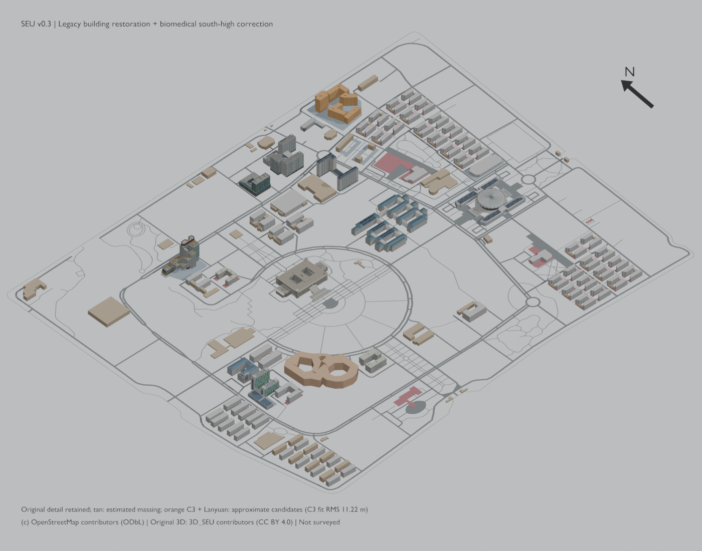
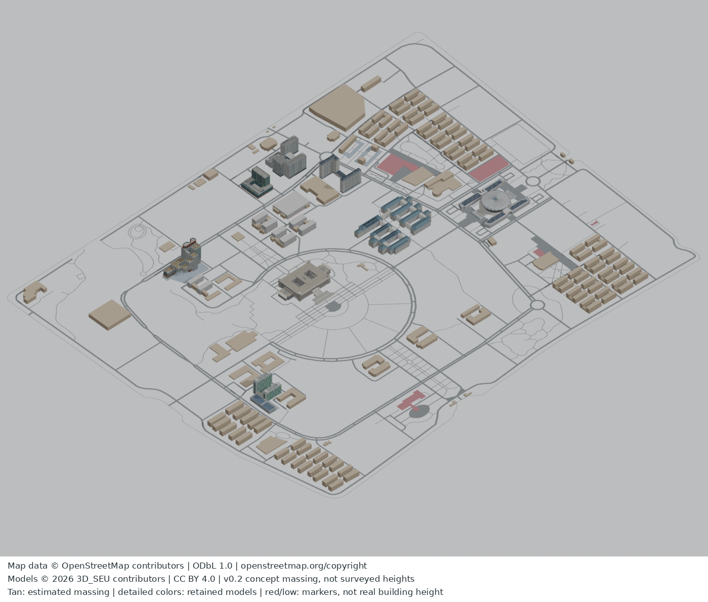
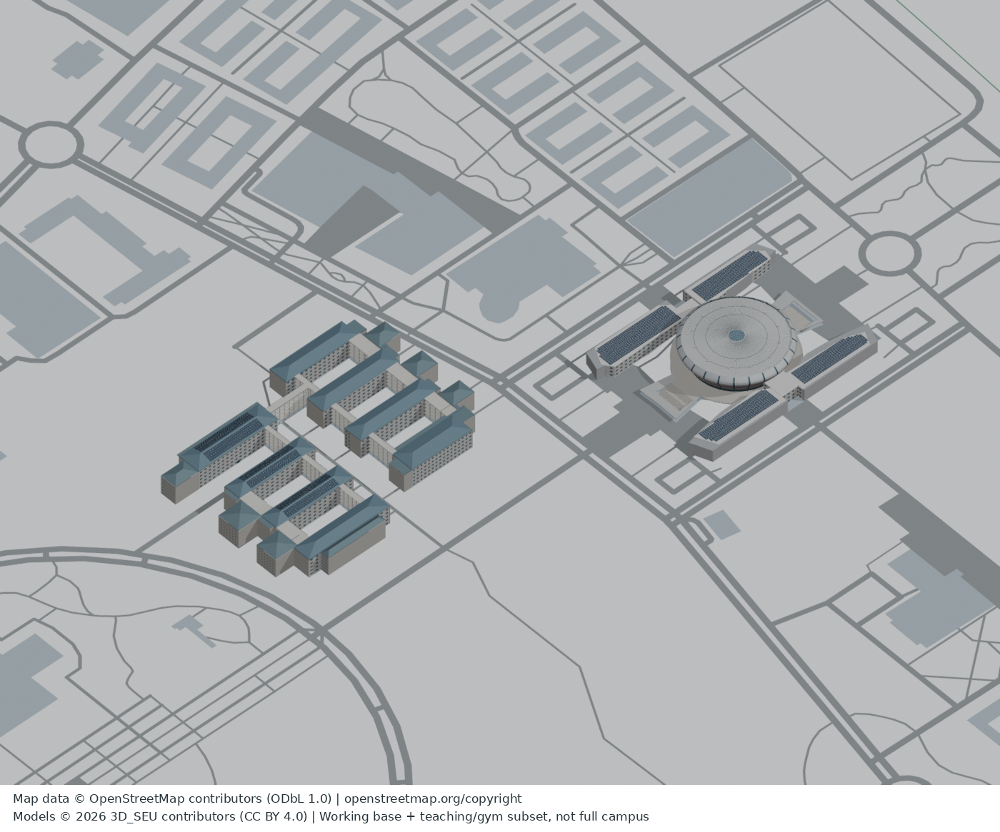

# 3D_SEU 校园3D资产与AI协作框架

仓库：https://github.com/one-num-three/3D_SEU

这是九龙湖校园重建项目：轻量 AI 协作框架用于任务认领、独立模块、交接证据与统一验收；`public_assets/`、`public_assets_v02/` 与 `public_assets_v03/` 分版保留已审核的校园基底、工作模型、体块样板和本轮修复。**这不是完整校园最终模型；不附私人照片或卫星截图。**框架与资产分别记录许可和清单，未收录资产不因此自动开放。

本框架代码与文档采用 [MIT License](LICENSE)，Copyright (c) 2026 3D_SEU contributors。第三方地理数据、影像、字体及模型资产不因本LICENSE被重新授权；见 [NOTICE.md](NOTICE.md)。

## 最新：两座食堂 v0.7 / 网页 v0.7.0

[在线查看](https://one-num-three.github.io/3D_SEU/) · [v0.7 来源、许可与限制](public_assets_v07/README.md)

橘园食堂和桃园北食堂本轮各重建为两层外观，按精确清单用 30 个新网格替换 2 个旧对象；完整检查点为 2879 个作者网格对象，不是楼栋数。桃园北食堂先前整楼被压成 0.35 米薄片是通道分类误判，本轮恢复楼体并保留东南上层投影下的局部架空通道，不把通道封死。橘园食堂从旧 4 米体块细化为官方说明的两层外观；两座楼的 9.8 米高、通道 4.65 米净高及立面细部尺寸仍为估计，不是测量结果。

原 v0.5 泳馆／桃园／梅园、v0.6 橘园宿舍／土木四联试验厅、603 个程序树位、道路和地表均保留。网页仍提供可选、可关闭的合批显示优化和分层抗闪烁；不改变原地理坐标、全局比例和其他建筑。并未批量抬高其余矮标记，也不包含后续行政楼草稿。

新目录由 `public_assets_v07/ASSET_MANIFEST.json` 独立校验，v0.1–v0.6 资产逐字节保留。官方参考照片只用于观察，不上传照片像素或第三方纹理；地理数据 ODbL、自创视觉贡献 CC BY 4.0、代码 MIT，具体权利边界见分层许可。背立面、屋面和未见细部仍简化，手机实渲与 FPS 不以无 GPU 的解析测试代替。

## 网页 v0.6.1：可选显示优化

[在线查看](https://one-num-three.github.io/3D_SEU/) · 建筑局部 v0.6、地表 v0.4、估计植被 v0.6 均不变。

新增可开关的静态建筑合批：不改变三角形、原材料、坐标或泳馆定位，在内存预算内将同材质建筑合并为较少的绘制提交。Node 几何检查中，64 MiB 输出几何上限将建筑与地表的估计绘制提交从 3202 降至 1016；这不是实机帧率测试，也不保证手机帧率。树木绘制预算另计。

设备内存信息仅是粗略分档，不是可用内存；未知或不超过 2 GB 时默认关闭，4 GB 使用 24 MiB、至少 8 GB 使用 64 MiB 的输出几何上限，可手动关闭并恢复原显示。内存仍需容纳原模型、额外 CPU/GPU 副本及驱动开销，上限不代表总内存峰值。失败、取消或低预算均回退到原模型；分层地表抗闪烁、泳馆定位与树木开关保留。旧 v0.1–v0.6 资产逐字节不改，无新增参考照片。

## 局部建筑 v0.6 / 网页 v0.6.0

[在线查看](https://one-num-three.github.io/3D_SEU/) · [v0.6 来源与限制](public_assets_v06/README.md)

本轮增加土木／交通四跨试验厅和橘园六条宿舍的外观细部，按精确清单替换 25 个旧对象、添加 93 个新对象；全校检查点为 2851 个作者网格对象，不是楼数。试验厅不是旁侧办公双塔；墙高沿用旧 15 米估值，不由立面六排窗推定六层。v0.5 泳馆、桃园、梅园更新及其他既有部分全部保留，v0.1–v0.5 发布文件不改。

网页新增可开关的程序化景观：完整 603 棵候选树位，手机默认上限 384 棵，并调整 398 个既有道路网格的显示材质。**树位是按公开基底及避让规则生成的展示方案，不是实测树木数据库**；不声称道路已按实地工程重建。地表分层抗闪烁方案继续保留；本版不包含尚未接入的道具候选。

新资产由 `public_assets_v06/ASSET_MANIFEST.json` 独立校验。外部参考照片仅观察、不上传像素或纹理；OSM 地理数据 ODbL、自创视觉贡献 CC BY 4.0、代码 MIT，具体边界见许可与来源说明。尺寸、楼高、未见立面和近似候选仍有不确定性；浏览器无 GPU 的解析测试不替代手机实渲与性能验收。

## 局部建筑 v0.5 / 网页 v0.5.0

[在线查看](https://one-num-three.github.io/3D_SEU/) · [本轮资产与来源](public_assets_v05/README.md) · [泳馆与桃园预览](public_assets_v05/previews/V05_POOL_TAOYUAN_CONTEXT.png)

本轮更新游泳馆 1 座、桃园 8 条宿舍与梅园九舍 4 条宿舍：外廓、屋面、墙窗及材料逐模块重建。按精确清单替换 54 个旧对象、添加 111 个新对象，保留其余 2672 个原对象；2783 是网格对象数，不是楼栋数。原始 v0.1–v0.4 资产保留不改，浏览器在固定 v0.3 基础上载入独立 v0.5 增量，继续使用 v0.4 地表。来源照片仅用于观察，不公开原像素、不嵌入纹理。

网页保留 v0.4.1 的分层地表渲染与泳馆定位、保留建筑原材质。该发布是阶段性改进，不是全校精模完成：估计尺寸、楼高及 C3／兰园近似定位限制仍有效。新增资产由 `public_assets_v05/ASSET_MANIFEST.json` 独立校验；分层许可不变。真机显示与性能需继续验收，不把无 GPU 环境的解析检查冒充手机实渲通过。

## v0.4.0 轻快底图与显示修复

[在线查看校园](https://one-num-three.github.io/3D_SEU/) · [v0.4 地表说明](public_assets_v04/README.md)

网页 v0.4.0（2026-10-28）在原建筑模型 v0.3 上叠加同坐标的地表层：106 项 OSM 地表要素及一层底板，区分绿地、水面、运动场和施工区；采用浅暖建筑、柔绿地面与湖蓝水面。道路与地面的深度显示修复属于网页显示层，不改建筑高度、轮廓或既有道路几何。C3／兰园仍是近似位置候选，不代表实测或完整校园。

v0.1、v0.2、v0.3 原资产逐字节保留。新增地表独立使用 `public_assets_v04/ASSET_MANIFEST.json`，网页使用 `preview/FILE_MANIFEST.json`；代码 MIT、自有视觉贡献 CC BY 4.0、OSM 派生地理数据 ODbL 1.0，具体来源和边界见各版说明。无私人照片或卫星截图。

## v0.3 生医南向修正与旧楼恢复

[工程说明](public_assets_v03/README.md) · [全景](public_assets_v03/previews/CAMPUS_OBLIQUE.png) · [完整Blender](public_assets_v03/assets/SEU_campus_restored_v03.blend) · [完整GLB ZIP](public_assets_v03/assets/SEU_campus_restored_v03_GLB.zip)（解压后打开GLB）

生医高楼已改南侧；恢复旧宿舍、学院和游泳馆细部。工科C3和兰园独立标为近似候选，行政及部分翼楼仍待核，不等同全校完成。2726是网格组件数，不是楼数。保留v0.1/v0.2回退。

代码MIT、自有视觉贡献CC BY4.0、OSM派生地理数据库ODbL1.0；C3事实来源及第三方权利边界另列，不将原规划图重新授权。无原始私人照片、卫星截图或第三方纹理。

本版ASSET_MANIFEST独立覆盖174文件（其中173哈希条目＋清单本身）；DEPENDENCIES记录三项固定上版输入。完整模型可独立打开；源复建需整个仓库保留相邻public_assets_v02。



## 全校体块样板 v0.2

[查看v0.2资产与逐源轮廓状态](public_assets_v02/README.md)：已保留的教学/体育馆及其他已有细部，加其余建筑估高体块；高度/未映射庭院尚未实测。v0.1仍保留。



[整体GLB](public_assets_v02/assets/SEU_campus_massing_v02.glb) · [Blender源文件](public_assets_v02/assets/SEU_campus_massing_v02.blend) · [201源轮廓状态清单](public_assets_v02/BUILDING_STATUS.json)

数据ODbL、原创视觉CC BY4.0、代码MIT；v0.2由public_assets_v02/ASSET_MANIFEST.json独立校验，不以框架或v0.1清单冒充全仓库清单。

## 已提供的真实3D资产 v0.1

[打开资产目录](public_assets/README.md)：全校OSM建筑/道路基底＋已做教1–8和体育馆。包含可编辑Blend、GLB、源数据库、重建脚本和许可，非完整校园最终模型。



- [下载组合GLB](public_assets/assets/SEU_base_teaching_gym_v01.glb)
- [下载组合Blender模型](public_assets/assets/SEU_base_teaching_gym_v01.blend)
- [来源、坐标、许可与重建](public_assets/README.md)

框架代码MIT；原创模型视觉贡献CC BY4.0（3D_SEU contributors）；OSM派生地理数据ODbL。框架根FILE_MANIFEST只描述框架文件，本批资产由public_assets/ASSET_MANIFEST.json独立覆盖。

## 5分钟接手
1. 读 `project_contract.json` 和 `AGENTS.md`。
2. 读 `tasks.json`，选角色；任务尚未启动，角色不是正在运行的AI。
3. 管理员在**同一协调工作区**初始化：`python3 tools/coop.py init --db coordination.sqlite --tasks tasks.json`。
4. worker认领：`python3 tools/coop.py claim --db coordination.sqlite --task TEACH-DETAIL --actor agent-teaching`。SQLite事务提供同一数据库上的唯一认领；单纯提交JSON不提供原子性。
5. 只写自己的module目录，产出证据JSON，再调用submit。独立QA调用review，维护者统一合并。命令帮助见 `python3 tools/coop.py --help`。
6. 自检：`python3 tools/test_coop.py`。

## 多机器 / Git
不能把SQLite数据库复制到各clone再称全局锁。跨机器使用**单一维护者认领台账**：worker开认领PR，由维护者串行核准唯一任务owner后才开工；实际分支 `task/<ID>/<actor>`，模块一人写，共享基底只读，几何修改PR和证据分开审。当前包没有远程协调服务/GitHub自动化，也未验证网络文件系统锁语义。SQLite仅用于本机共享工作区演示和协作。

`docs/RELEASE_READINESS.md`列框架与模型的发布边界；`CONTRIBUTING.md`规定交接。不要把“工具测试通过”解读为全模型许可或几何验收通过。

## 提交与审查例子
```sh
python3 tools/coop.py submit --db coordination.sqlite --task TEACH-DETAIL --actor agent-teaching --root . --evidence modules/teaching_detail/evidence.json
python3 tools/coop.py review --db coordination.sqlite --task TEACH-DETAIL --actor independent-reviewer --root . --decision accept
python3 tools/coop.py status --db coordination.sqlite
```
`examples/evidence.template.json`必须填真实SHA和报告文件；空模板故意不能提交。当前CLI不自动运行几何建模、不替你上传PR，也不管理第三方登录。

框架v0.1已发布；本批3D资产的范围与复核结果见 `public_assets/README.md`。`init --root .`会在空工作区创建各任务module目录，不需要先有模型文件；真实任务仍需获得授权输入。
