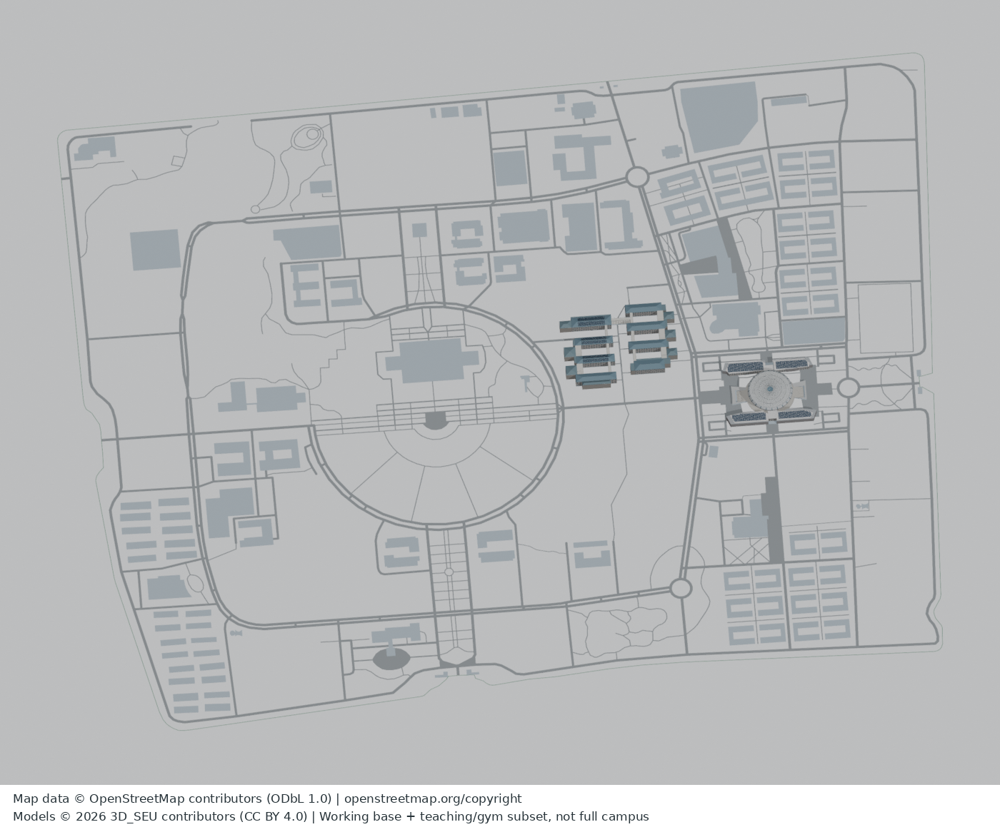

# 真实3D资产 v0.1：校园基底＋教1–8＋体育馆

这不是只有文档的框架包：包含可编辑Blend与可直接导入查看的GLB。保留已完成部分的实际几何，不是重做灰盒。

## 直接打开
- **组合GLB**：[`assets/SEU_base_teaching_gym_v01.glb`](assets/SEU_base_teaching_gym_v01.glb)，含全校基底及教学/体育馆细部，下载后拖入支持glTF的查看器。
- **组合Blender源文件**：[`assets/SEU_base_teaching_gym_v01.blend`](assets/SEU_base_teaching_gym_v01.blend)，用Blender4.3或兼容版本打开。
- 只看基底：`base/SEU_OSM_BASE_v01.blend` / `.glb`。
- 只看已做楼体：`detail/seu_teaching_gym_detail_v01.blend` / `.glb`。

GitHub普通文件页不保证直接显示3D；请用Raw/Download下载GLB或Blender打开。此批没有启用GitHub Pages或上传任何第三方模型查看服务。

## 实际范围与限制
- 600个基底mesh：201个OSM源建筑轮廓薄板、398道路面、1校园边界。201是源多边形数量，不是已完成201栋楼；薄板仅8cm厚作底图，不是重复的高层楼体。
- 239个已完成部分mesh，覆盖8栋教学楼和体育馆；原33.9万顶点/56.9万三角面保留，没有减面。已做连廊、屋顶、光伏、补翼和体育馆细部可见。
- 总计839个mesh。没有包含全校其他历史3D楼体、树木、人群或本轮暂停的桃园西。它不是完整R3D校园模型，也不是测绘定稿。
- 地面实体和上层屋面/廊缘分别建模；教学教2/7北侧上层边界及各层高度仍有推定，体育馆南北入口槽口保持开放。道路宽度按OSM可用标记或分类估计，不是实测。
- 为便于网页传输，组合及detail GLB不导出冗余法线/UV，由viewer按几何生成法线；没有改动三角几何或颜色，显示阴影可能随viewer不同。Blend保留可编辑表面。

## 坐标
Blender：米，X向UTM格网东、Y向格网北、Z向上；EPSG:32650固定原点E=671709.6990725585、N=3529586.400278158。GLB采用标准glTF Y-up转换：X=x,Y=z,Z=-y。不可混用GCJ-02/BD-09。Z无测量高程基准。WGS84数据见`base/data/base.wgs84.geojson`，可逆规则见`base/data/CRS.json`。

## 源数据、重建和验收
- 原始OSM快照及最终地理基底：`base/sources/osm/`、`base/data/`。
- 真正用于生成细部的最终机器可读几何：`detail/geometry_database.json.gz`，包含顶点/面/颜色/稳定ID及假设；不是只放原OSM却漏掉修改数据。
- `detail/rebuild_clean.py`从公共数据库独立重建，不依赖私人原模型或照片；`base/scripts/build_data.py`从OSM快照重建地理数据。具体命令见各子目录README。
- 组合：`blender -b -t 2 --python scripts/integrate_public.py`。
- 文件与隐私检查：`python3 scripts/validate_release.py`；组合冷开/回导：`blender -b -t 2 --python scripts/validate_models.py`。
- 本目录独立清单为`ASSET_MANIFEST.json`，根目录框架的18文件清单不覆盖本批资产。

## 许可及来源
**模型原创视觉贡献：3D_SEU contributors，CC BY 4.0。地图与派生地理/几何数据库：© OpenStreetMap contributors，ODbL 1.0。代码：MIT。**不同权利同时存在，不把整个GLB或数据库笼统改成MIT/CC BY。见`licenses/README.md`、`detail/SOURCES_AND_RIGHTS.json`及`base/data/PROVENANCE.json`。

模型以独立程序几何表达OSM轮廓和可观察建筑布局/构件；参考照片/截图的像素、摄影测量数据、第三方模型、树皮贴图、字体软件及私人凭据均未加入此包。许可只及我们可授权的贡献，不表示校方背书，也不保证排除所有其他适用权利。原图不因模型许可自动公开。
